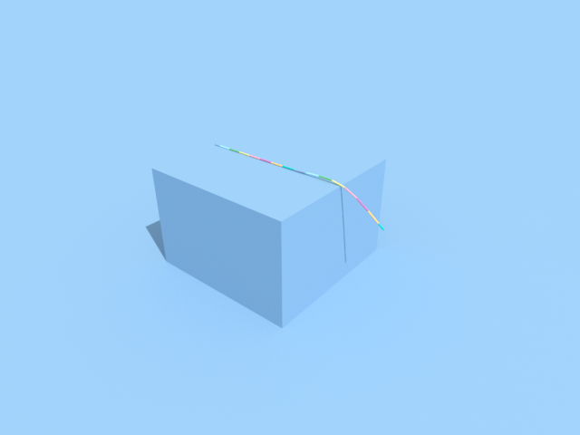

# Cables

Add a cable with `scene.add_rod`: it bends, twists and stretches like the material you name, and rests on objects.

## 1. Lay a cable over a table edge

```python
import alloy

scene = alloy.Scene(dt=0.01)
scene.add_ground()
scene.add_box("table", size=(0.3, 0.3, 0.2), pos=(0, 0, 0.1), static=True)       # top at z = 0.2
scene.add_rod("cable", length=0.4, radius=0.0015, pos=(-0.15, 0, 0.21), direction=(1, 0, 0), segments=16)
sim = alloy.build(scene)
print(sim.routes()["cable"]["route"])
```

```text
chain
```

The cable starts flat, 1 cm above the table, and 10 cm of it sticks out past the table edge at x = 0.15. Without a
clamp it is a fast chain of rigid segments joined by springs, which is what `sim.routes()` reports.

## 2. Run it and read the centre line

```python
sim.run(1.0)
points = sim.state(["cable"], world=0)["cable.points"]
print(points.shape, points[-1][[0, 2]].round(2))       # the free end's x and z
```

```text
(17, 3) [0.24 0.15]
```

`"cable.points"` is the centre line from start to end, one row per segment end. The cable settled onto the
table and its overhang bent down over the edge: the free end is at x = 0.24, z = 0.15 m, below the table top at 0.2.

## 3. Save a picture

```python
sim.render(width=640, height=480, path="cables.png")
print(sim.check()["ok"])
```

```text
True
```



## Limits

- A clamped cable (`clamp="start"`) steps on a slower solver. Beside a robot on the CPU it costs 83-95 s per simulated
  second on an AMD EPYC 7B13, and `route="chain"` keeps it on the fast chain, about 60x faster
  ([cost](../../known_gaps/rod-vbd-beside-robot-cost.md)).
- A chain held by a robot on the CPU slowly loses its twist while held, about 0.14 % per second
  ([details](../../known_gaps/rod-chain-grip-slips.md)). Clamp a cable that must hold a twist for long.
- A cable that needs more than 40 segments (long or soft) also steps on the slower solver, wherever it lies.

## Next

- Grip a cable with a robot: [Robots](robots.md).
- Drape a sheet instead: [Cloth](cloth.md).
- Read the health checks: [World health](health.md).
