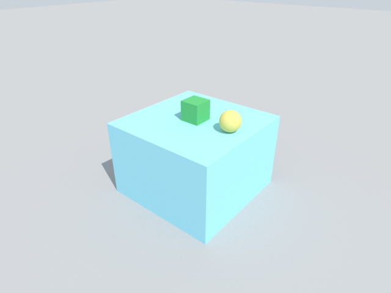

# Camera

Render a picture of a scene, place a named camera, and read a depth image.

## 1. Render a picture

```python
import alloy
import numpy as np

scene = alloy.Scene(dt=0.01)
scene.add_ground()
scene.add_box("table", size=(0.6, 0.6, 0.4), pos=(0, 0, 0.2), static=True)
scene.add_box("block", size=(0.1, 0.1, 0.1), pos=(0, 0, 0.45), mass=0.2)
scene.add_sphere("ball", 0.05, pos=(0.2, 0, 0.45), mass=0.2)
sim = alloy.build(scene)
sim.run(0.5)

image = sim.render(width=640, height=480, path="camera.png")
print(image.shape, image.dtype)
```

```text
(480, 640, 3) uint8
```



`sim.render` frames world 0 automatically and returns the picture as a `(height, width, 3)` array of 8-bit colour.
`path=` also saves it as a PNG. Look at a new scene once before a long run.

## 2. Place a camera

```python
cam = alloy.Camera("front", look_at=((1.2, -1.0, 0.9), (0, 0, 0.4)), width=160, height=120)
views = sim.render(cam)
print(views.shape, views.dtype)
```

```text
(1, 120, 160, 3) uint8
```

`look_at=(eye, target)` puts the camera at `eye` looking at `target`. A camera renders every world, so the array has a
leading world axis: `(worlds, height, width, 3)`.

## 3. Read depth

```python
depth = sim.render(cam, output="depth")
seen = depth[np.isfinite(depth)]
print(depth.shape, depth.dtype, "nearest", seen.min().round(2), "m")
print("share of pixels with no hit:", round(float(np.isinf(depth).mean()), 2))
```

```text
(1, 120, 160) float32 nearest 1.06 m
share of pixels with no hit: 0.3
```

`output="depth"` gives the distance in metres for each pixel, and `inf` where nothing is hit. Use
`output="segmentation"` for an integer id per pixel.

## Limits

- There is no sensor model: no noise, and no range limit other than the camera's clip distances.
- A glass object renders as an opaque surface ([glass is opaque](../../known_gaps/camera-glass-opaque.md)).
- The camera images of the ready-made training environments are small, bright and grainy
  ([env camera images](../../known_gaps/camera-env-images.md)).

## Next

- Add a robot to look at: [Robots](robots.md).
- Train from state: [Train with RL](rl.md).
- Check a run before you trust it: [World health](health.md).
