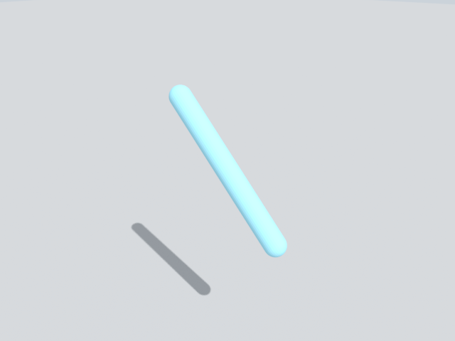

# Robots

Add a robot to a scene, drive one joint along a ramp, and read its angle back.

## 1. Add a robot from an MJCF string

The robot here is one hinge arm. `add_robot` takes an MJCF string (`mjcf=`) or a file path: MJCF or URDF, and USD
after `pip install "alloy-engine[usd]"`. A file that loads meshes may need `pip install "alloy-engine[import]"`.

```python
import alloy

ARM = """<mujoco><compiler angle="radian"/><worldbody><body name="link1" pos="0 0 0.1">
  <joint name="shoulder" type="hinge" axis="0 1 0" range="-2 2" damping="2"/>
  <geom type="capsule" fromto="0 0 0 0.3 0 0" size="0.02" mass="1"/>
  </body></worldbody>
  <actuator><position joint="shoulder" kp="200" kv="10"/></actuator></mujoco>"""

scene = alloy.Scene(dt=0.01)
scene.add_ground()
scene.add_robot("arm", mjcf=ARM, pos=(0, 0, 0.5))
sim = alloy.build(scene)
print(sim.names()["joints"])
```

```text
['arm/shoulder', 'shoulder']
```

Robot parts are named `"<robot>/<part>"`. A joint name that is unique also works without the robot prefix.

## 2. Drive a joint and read its angle

```python
traj = sim.run(1.0, record=["arm/shoulder"], targets={"shoulder": (0.0, 0.8)})   # ramp 0 -> 0.8 rad over 1 s
print(traj["arm/shoulder.q"].shape, traj.world(0)["arm/shoulder.q"][-1].round(2))
sim.set_targets({"shoulder": 0.8})                   # hold; a target stays until you change it
sim.step(50)
print(sim.state(world=0)["arm/shoulder.q"].round(2), sim.check()["ok"])
sim.render(width=640, height=480, path="robots.png")
```

```text
(101, 1) 0.76
0.81 True
```

The joint follows the ramp with a small lag (0.76 rad at the end of the ramp), then settles near the 0.8 target
(0.81 here).



Move with ramps: a large jump in a target makes a stiff servo kick hard.

## 3. A shipped robot

Alloy ships robot files, for example the Franka Panda. Its file is a whole scene with its own floor and table, so
add no ground.

```python
from alloy.cards.library import default_root

path = default_root() / "robots" / "emb_e2_panda" / "scene.xml"
scene = alloy.Scene(dt=0.01)
scene.add_robot("panda", path)
sim = alloy.build(scene)
sim.run(0.2, targets={"panda/joint1": (0.0, 0.5)})
print(sim.state(world=0)["panda/joint1.q"].round(2), sim.check()["ok"])
```

```text
0.3 True
```

The 0.2 s ramp aimed at 0.5 rad, and the servo had reached 0.3 rad when the run ended. Other shipped robots include
the Franka FR3, a UR10e, two humanoids, a quadruped and a hand.

## Keep in mind

- MJCF reads angles (joint `range`, `euler`) in degrees unless the file says `<compiler angle="radian"/>`; targets
  are always radians. A hinge with range `-2 2` and no such line moves only 2 degrees each way.
- A joint with no actuator cannot be driven: `set_targets` raises an error that names the line to add.
- There is no call that attaches or welds an object to a gripper, so a grasp holds only through friction and finger
  force ([no attach or weld](../../known_gaps/grasp-no-attach-or-weld.md)).
- A grasp can come out differently on a CPU and a GPU: one measured grasp held on a GPU and slipped on the CPU, with
  health OK on both. Check a grasp on the device you train on.
- Alloy steps your MJCF with its own settings: the file's `timestep`, `integrator` and `cone` are not used; its
  `solver`, `iterations`, `tolerance` and `impratio` are (measured on the CPU). A robot starts at joint angle 0, not
  at a keyframe, and no call reads the file's `<sensor>` elements.

## Next

- Train a policy on a robot task: [Train with RL](rl.md).
- Record demonstrations: [Imitation learning](imitation.md).
- Look at the scene: [Camera](camera.md).
