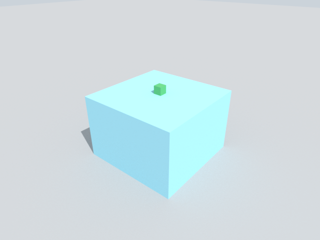

# Alloy

A physics engine for robot learning: robots, cloth, liquids and cables in one scene, in many worlds on one GPU.

```bash
pip install alloy-engine
```

Python 3.11 or 3.12, in a virtual environment. If your machine has an older Python, `uv venv -p 3.12 --seed` makes
one with pip in it; the [Quickstart](quickstart.md) has the full lines.

Open source under [Apache-2.0](https://github.com/argonrobotics-ai/alloy/blob/main/LICENSE).

```python
import alloy

scene = alloy.Scene(dt=0.01)
scene.add_ground()
scene.add_box("table", size=(0.6, 0.6, 0.4), pos=(0, 0, 0.2), static=True)
scene.add_box("block", size=(0.05, 0.05, 0.05), pos=(0, 0, 0.6), mass=0.2)
sim = alloy.build(scene)
sim.run(1.0)
print(sim.state(world=0)["block.pos"].round(3), sim.check()["ok"])
sim.render(width=640, height=480, path="block.png")
```

```text
[0.    0.    0.425] True
```



The block falls 17.5 cm, lands on the table and rests with its centre at 0.425 m. `True` means every world passed
its health checks.

## Where next

- [Quickstart](quickstart.md): your first simulation and image, step by step.
- [What ships](what-ships.md): the ready-made environments, robots and object libraries, with counts.
- [Use Alloy with your coding agent](agents.md): one prompt to paste, and what to ask for.
- Guides: [Robots](guides/robots.md), [Train with RL](guides/rl.md),
  [Imitation learning](guides/imitation.md), [Camera](guides/camera.md), [Liquids](guides/liquids.md),
  [Cloth](guides/cloth.md), [Cables](guides/cables.md), [World health](guides/health.md).
- [Errors and fixes](errors.md): what each error means and what to change.
- [Keep in mind](keep-in-mind.md): what does not work yet, one line each.

Alloy is built on Newton, MuJoCo Warp and Warp. It runs on an NVIDIA GPU, or on the CPU when there is none.

Speed depends on what shares the scene. A robot with water, or a robot with a cable, runs well in many worlds; a
robot with a cable and cloth together steps very slowly. Run `alloy.estimate(scene, worlds, seconds)` before a long
run: it predicts the wall time.
