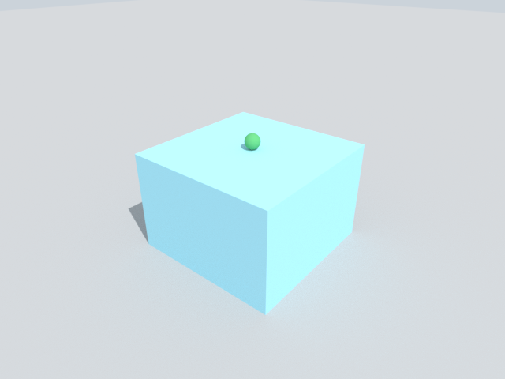

# Quickstart

Drop a ball on a table, read where it went, and save a picture. About 10 minutes, most of it the first run's
one-time compile.

## 1. Install

```bash
python3 -m venv .venv && source .venv/bin/activate     # Python 3.11 or 3.12
pip install alloy-engine
```

Alloy needs Python 3.11 or 3.12: on an older Python, pip answers "from versions: none". Two common cases:

```bash
sudo apt install python3.12-venv     # Ubuntu 24.04: python3 -m venv fails without it
uv venv -p 3.12 --seed && source .venv/bin/activate     # any machine with uv: fetches Python 3.12, with pip
```

Alloy uses an NVIDIA GPU when it finds one (driver 580 or newer) and the CPU otherwise. Nothing else to set up.

Alloy is the physics engine from Argon Robotics. The package is `alloy-engine`; the import is `alloy`.
`pip install alloy` installs a different project. Alloy is not related to Alloy Robotics, Grafana Alloy or the Alloy
modelling language.

## 2. Build a scene

Sizes are full edge lengths in metres, masses in kilograms, and z points up.

```python
import alloy

scene = alloy.Scene(dt=0.01)                 # one sim.step() advances 10 ms
scene.add_ground()
scene.add_box("table", size=(0.6, 0.6, 0.4), pos=(0, 0, 0.2), static=True)
scene.add_sphere("ball", 0.03, pos=(0, 0, 0.8), restitution=0.6)
sim = alloy.build(scene)                     # a GPU if there is one, else the CPU
print(sim.names()["bodies"])
```

```text
['ball']
```

The first run of a new kind of scene compiles kernels once: about 45 s on a CPU (41 s on an 8-vCPU Linux machine,
44 s on an Apple-silicon Mac) and 3 to 4 minutes on an NVIDIA GPU (190 to 240 s on L4s). A robot scene can take
up to about 8 minutes on a GPU: a first `PickCube-v0` build took 7.4 min on an L4. The result is cached, so later
runs start in seconds.

## 3. Run it and read the result

```python
traj = sim.run(1.0, record=["ball"])         # 1 simulated second, one frame per step
z = traj.world(0)["ball.pos"][:, 2]
print(traj["ball.pos"].shape, "lowest", z.min().round(3), "end", z[-1].round(3))
```

```text
(101, 1, 3) lowest 0.427 end 0.432
```

A trajectory is a dict of NumPy arrays shaped `(frames, worlds, ...)`. The ball's centre comes down to 0.427 m, just
under table top plus radius, and is still bouncing a little at the end.

## 4. Save a picture

```python
sim.render(width=640, height=480, path="ball.png")
```



## 5. Check the run

```python
print(sim.check()["ok"], sim.health()["worlds"][0]["severity"])
```

```text
True OK
```

Read this after every run. A world that fails is frozen in place and looks calm, so the numbers alone do not show
it. More in [World health](guides/health.md).

## 6. Run many worlds at once

```python
import numpy as np

many = alloy.Scene(worlds=4, dt=0.01)
many.add_ground()
drops = np.array([[0, 0, 0.2], [0, 0, 0.4], [0, 0, 0.6], [0, 0, 0.8]])
many.add_sphere("ball", 0.03, pos=drops, restitution=0.6)     # one start per world
sim = alloy.build(many)
sim.run(0.1)
print(sim.state(["ball"])["ball.pos"][:, 2].round(2))
```

```text
[0.15 0.35 0.55 0.75]
```

Every array now has four rows, one per world: each ball fell the same 5 cm in 0.1 s.

## Next

- Add a robot: [Robots](guides/robots.md).
- Train a policy: [Train with RL](guides/rl.md).
- Pour water or drape a sheet: [Liquids](guides/liquids.md), [Cloth](guides/cloth.md).
